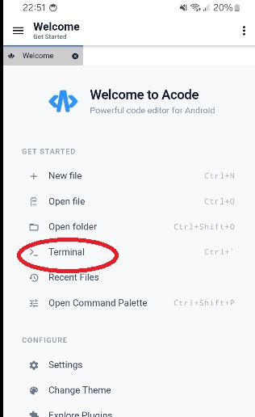
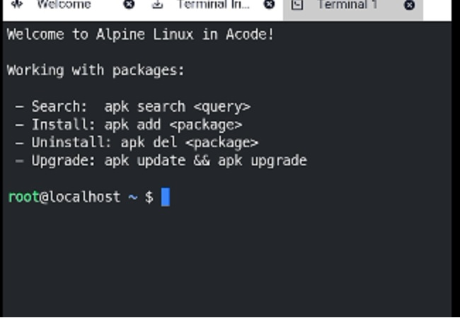

# Configuración Inicial

En esta sección vamos a comenzar a preparar un entorno de trabajo. Para ello necesitamos obtener:
- Un editor de código
- Una terminal de trabajo
- Paquetes de software

> **Un Editor de código:** Al igual que un editor de texto, nos permite escribir nuestro código, pero además ofrece funcionalidades o extensiones especiales que nos ayudarán en el desarrollo.

> **Una terminal** es una interfaz que nos permite ejecutar órdenes en el sistema.

> **Un paquete de software** es un programa o conjunto de programas escritos por desarrolladores o empresas para ejecutar una instrucción o un código.

---

### Descargar e instalar el editor de código

Ingresan a la Playstore de android y buscan la aplicación `Acode` e instalan.


Una vez abierta veran la terminal integrada:



Cuando ingresemos a la comenzara a instalarse el emulador automaticamente, y si el proceso exitoso deberiamos ver la presentación del sistema de gestión de paquetes de Alpine linux(apk)



## Instalación de paquetes globales

Primero, realizamos la actualización de la herramienta de descarga de paquetes nativa de Linux (`apk`):
```bash
apk update && apk upgrade
```

Luego, instalamos las herramientas globales de desarrollo que utilizaremos en el curso y el soporte para comandos `sudo`:
1. Soporte para Sudo (`doas-sudo-shim`)
2. Python 3
3. Git
4. Curl
5. Pip y entornos virtuales

Ejecutar el siguiente comando en la terminal de Alpine:
```bash
apk add doas-sudo-shim python3 py3-pip git curl openssh tesseract-ocr tesseract-ocr-data-spa
```

Para instalar el motor de bases de datos PostgreSQL y sus librerías de desarrollo, ejecutamos:
```bash
apk add postgresql postgresql-contrib postgresql-dev
```

### Verificación de las instalaciones
Si la instalación fue exitosa, podremos verificar las versiones instaladas ejecutando:
```bash
psql --version
```
De igual manera, podemos comprobar el resto de las herramientas concatenando sus comandos de verificación:
```bash
git --version && curl --version && pip3 --version
```

---

**Comandos de activación / desactivación de PostgreSQL**

Alpine Linux utiliza **OpenRC** como sistema de gestión de servicios. Antes de iniciar el servicio por primera vez, es necesario inicializar el clúster de la base de datos. Una vez instalado `doas-sudo-shim`, puedes usar `sudo`:

| Acción | Comandos en Alpine Linux (OpenRC) |
| :--- | :--- |
| **Preparar Base de Datos** | `sudo /etc/init.d/postgresql setup` *(Solo la primera vez)* |
| **Iniciar Servicio** | `sudo rc-service postgresql start` |
| **Detener Servicio** | `sudo rc-service postgresql stop` |
| **Reiniciar Servicio** | `sudo rc-service postgresql restart` |
| **Estado del Servicio** | `sudo rc-service postgresql status` |
| **Habilitar Servicio** | `sudo rc-update add postgresql default` |
| **Ingresar a la consola** | `sudo -u postgres psql` |

---

## Instalar extensiones en VS Code

Para conectar nuestro editor con el entorno Linux, nos posicionamos en la sección de extensiones en el panel lateral de Visual Studio Code y buscamos la extensión oficial llamada **WSL** (además de las extensiones de **Python** y **Jupyter**).

[Siguiente Lección: Bash](../../../04-bash/bash.readme.md)
