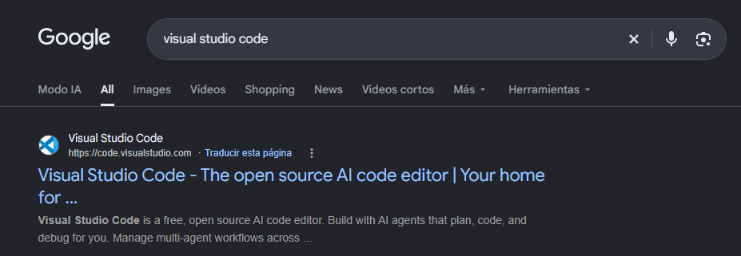
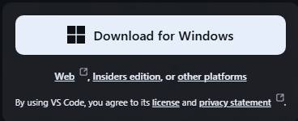
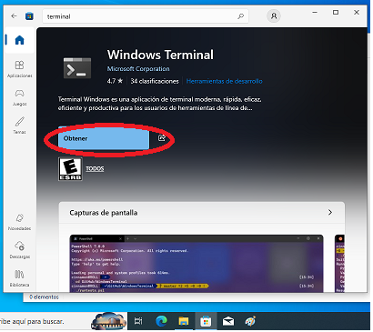
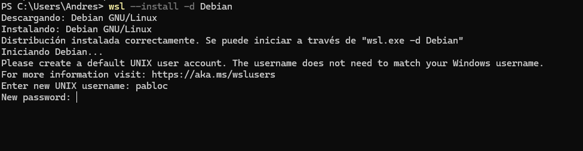
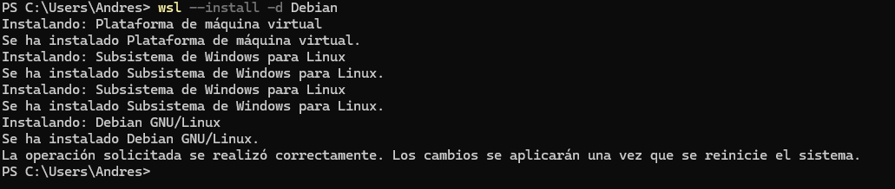
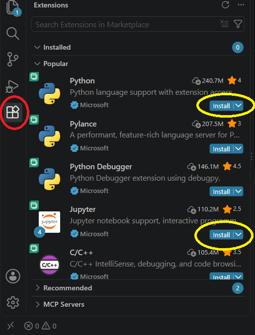

# Configuración Inicial

En esta sección vamos a comenzar a preparar un entorno de trabajo. Para ello necesitamos obtener:
- Un editor de código
- Una terminal de trabajo
- Paquetes de software

> **Un Editor de código:** Al igual que un editor de texto, nos permite escribir nuestro código, pero además ofrece funcionalidades o extensiones especiales que nos ayudarán en el desarrollo.

> **Una terminal** es una interfaz que nos permite ejecutar órdenes en el sistema.

> **Un paquete de software** es un programa o conjunto de programas escritos por desarrolladores o empresas para ejecutar una instrucción o un código.

---

### Descargar e instalar el editor de código

Ingresen a `https://google.com.ar` y busquen `visual studio code`.



Hacemos clic en:


---

### Descargar e instalar terminal PowerShell 7+

Abrimos la Store integrada en Windows que tenemos en la barra de tareas:



[Descargar directamente desde la plataforma de Microsoft (Instalador MSI)](https://learn.microsoft.com/en-us/powershell/scripting/install/install-powershell-on-windows?view=powershell-7.6#msi)

---

### Instalamos WSL1 o WSL2

WSL es un Subsistema de Linux para Windows que corre dentro del sistema operativo; es una funcionalidad que emula un entorno diferente. La diferencia entre la versión 1 y la versión 2 viene dada porque WSL1 es un traductor (hay una capa de traducción de comandos de Linux a Windows), mientras que WSL2 utiliza un hipervisor (una máquina virtual ligera que usa el kernel real de Linux).

Si la notebook o PC es antigua (anterior al 2010), seguramente vamos a necesitar usar **WSL1**, debido a que el procesador no tendrá las instrucciones de virtualización por hardware de fábrica (**Intel VT-x** o **AMD-V**).

Para asegurarnos de si el sistema soporta la versión moderna, primero probamos listar las distribuciones en línea con:
```powershell
wsl --list --online
```
Si este comando les devuelve un código de error relacionado con la virtualización (como el error `0x80370102`), confirmamos que la PC no la soporta. En ese caso, debemos forzar al sistema a usar la versión 1 ejecutando:
```powershell
wsl --set-default-version 1
```

Si la PC soporta WSL2 o ya ejecutaron el comando anterior para usar WSL1, procedemos a instalar la distribución **"Debian"** para mantener el entorno lo más liviano posible:
```powershell
wsl --install -d Debian
```

Durante el proceso se les solicitará un usuario y una contraseña. Esta última es **totalmente invisible** al ser tipeada por motivos de seguridad (¡CUIDADO, avancen a ciegas pero con atención!).



La salida esperada si el proceso es correcto es:



Si el proceso anterior fue exitoso, deberíamos poder abrir nuestra consola de PowerShell, escribir el comando `wsl` y ver cómo la terminal cambia para mostrar el entorno de Linux Debian.

---

## Instalación de paquetes globales

Primero, realizamos la actualización de la herramienta de descarga de paquetes nativa de Linux (`apt`):
```bash
sudo apt update && sudo apt upgrade -y
```

Luego, instalamos las herramientas globales de desarrollo que utilizaremos en el curso:
1. Python 3
2. Git
3. Curl
4. Pip y entornos virtuales

Ejecutar el siguiente comando en la terminal de Debian:
```bash
sudo apt install -y python3 python3-pip python3-venv python3-ipykernel curl git openssh-client openssh-server tesseract-ocr tesseract-ocr-spa -y
```

Para instalar el motor de bases de datos PostgreSQL, ejecutamos:
```bash
sudo apt install -y postgresql postgresql-contrib libpq-dev
```

### Verificación de las instalaciones
Si la instalación fue exitosa, podremos verificar las versiones instaladas ejecutando:
```bash
psql --version
```
De igual manera, podemos comprobar el resto de las herramientas concatenando sus comandos de verificación:
```bash
git --version && curl --version && pip3 --version
```

---

**Comandos de activación / desactivación de PostgreSQL**

| Acción | Comandos en WSL1 (SysV init) | Comandos en WSL2 (systemd) |
| :--- | :--- | :--- |
| **Iniciar Servicio** | `sudo service postgresql start` | `sudo systemctl start postgresql` |
| **Detener Servicio** | `sudo service postgresql stop` | `sudo systemctl stop postgresql` |
| **Reiniciar Servicio** | `sudo service postgresql restart` | `sudo systemctl restart postgresql` |
| **Estado del Servicio** | `sudo service postgresql status` | `sudo systemctl status postgresql` |
| **Habilitar Servicio** | *No soportado* | `sudo systemctl enable postgresql` |
| **Ingresar a la consola** | `sudo -i -u postgres psql` | `sudo -i -u postgres psql` |

---

## Instalar extensiones en VS Code

Para conectar nuestro editor con el entorno Linux, nos posicionamos en la sección de extensiones en el panel lateral de Visual Studio Code y buscamos la extensión oficial llamada **WSL** (además de las extensiones de **Python** y **Jupyter**).



## Vincular ipykernel con Jupyter Notebook.

Antes una breve explicación de que Jupyter Notebook. Originalmente Jupyter notebook es una interfaz web interactiva que nos permite crear documentos, llamado cuadernos, con extensiòn ".ipynb". Combina codigo ejecutable con texto markdown, formulas matemáticas o gráficos.

La ventana que nos otorga es que en vez de ejecutar todo el código de una sola vez nos permite ejecutar el codigo por partes, en celdas independientes.

Su principal fortaleza esta en el encapsulamiento del codigo y en la reproducciòn exacta de ese codigo.

Pero, su naturaleza, es ser una interfaz, no tiene un motor especifico que le permite interpretar el documento, y ahí es donde entra en juego el kernel, interprete o compilador de un lenguaje, que en este caso viene a su ser nuestro entorno "venv" o [Virtual Environment](../../../Fundamentos/fundamento.readme.md#virtual-environmententorno-virtual-o-venv).

Para que Jupyter pueda conocer ese entorno que nosotros creamos gracias al modulo de python "venv", debemos vincularlo

```Bash

python3 -m ipykernel install --user --name=<nombre-del-entorno> --display-name=<nombre-para-jupyter>
```
Salida esperada: `Installed kernelspec venv in /home/kscod/.local/share/jupyter/kernels/venv`


[Siguiente Lección: Bash](../../../Terminal/Bash/bash.readme.md)
