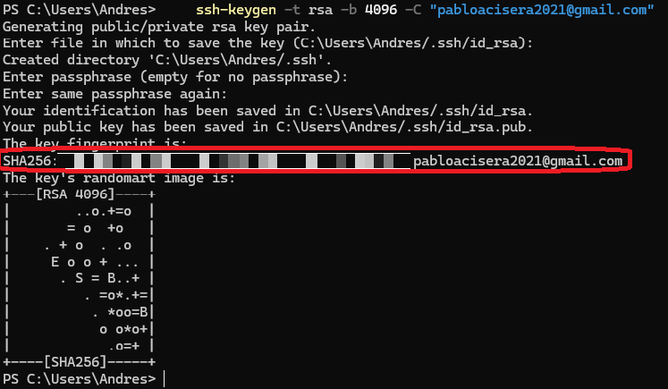

# ¿Que es SSH?

SSH significa Secure Shell y es un protocolo de red criptográfico que permite a dos temrinal(computadores) comunicarse de forma de segura entre ellas, en un entorno inseguro. 

Nos permite:
- Visualizar sistemas
- Transferir archivos
- Gestion Remota

Es el estandar en entornos de servidores Linux/Unix, en administracion de sistemas, infraestructura en la nube(cloud), gestión de repositorios, Despligue continuo.

> Resumen: conecta una terminal con un dispositivo, servidor o servicio local o remoto, mediante un canal encriptado.

La principal utilidad a nivel implementación, además de la criptográfia, es que podemos reemplazar contraseñas por pares de claves criptograficas.

### Flujo SSH

1. *Generación del par de claves*: mediante una función predefinida de ssh llamada `ssh-keygen`, que crea dos llaves, una privada, que guardaramos celosamente en nuestro dispostivio y en un dispositivo remoto o local seguro como por ejemplo "Hypervault" o  "Kapersky", e incluso algunos servicios cloud nos ofrecen sus propios vaults.

2. *Registro en servidor o servicio*: Este es el entorno de la clave publica. Usualmente, el estandar en linux es la siguiente ruta: `~/.ssh/authorized_keys`.

3. *Conexión o handshake*: el cliente le pide acceso al entorno remoto, y le envia la clave que quiere usar.

4. *Verficacion criptográfica*: El dispositivo remoto toma la llave que le enviamos, y busca la llave publica que le registramos y resuelve un "reto", si pasa devuelve acces.

5. *Respuesta*: puede ser de dos tipos "connected" o "refussed". Esto autoriza, sin que ninguna contraseña viaje por la red.

---
## Dos métodos de encriptación

Existe dos grandes formas de encriptar la comunicación en redes, Ed25559 y RSA. El mas antiguo es RSA, el cual multiplica numeros primos gigantescos, alrededor de 3072 caractéres para crear la llave. Su ventaja radica en que funciona en cualquier lado, en cualquier servidor, en cualquier entorno. La desventaja, es que es mas lento y pesado para el procesador y para la memoria.

Por otro lado, el Ed25519, esta basado en curvas elipticas avanzadas, solo ocupa 68 carácteres, es extreamdamente rapido, pero adaptado para entornos modernos.

**Crear un par RSA**

```Powershell
    ssh-keygen -t rsa -b 4096 -C "tu_correo@example.com"
```
- `-t`: tipo de cifrado;
- `-b`: bits o longitud de clave
- `-C`: comentario que identifica al usuario

Nos pregunta si queremos modificar el nombre del archivo que guarda las llaves. Si vamos a usar el nombre por defecto presionamos "enter"

`Enter file in which to save the key (C:\Users\Andres/.ssh/id_rsa):`

Nos confirmara la creación del archivo y nos pedira una palabra de seguridad, la cual no veremos al escribir, y la cual debemos recordar **para siempre**.

```
Created directory 'C:\Users\Andres/.ssh'.
Enter passphrase (empty for no passphrase):
```

Si el proceso fue exitoso deberias ver algo como:



En cuanto al par ed25519 es:

```Powershell
ssh-keygen -t ed25519 -C "tu_correo@gmail.com"
```

El resto del procedimiento es igual que para rsa.

[Siguiente Lección: Git](../Git/git.readme.md)