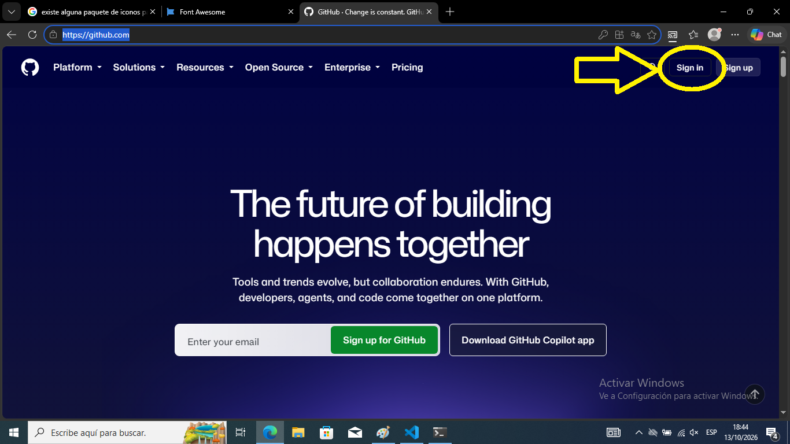
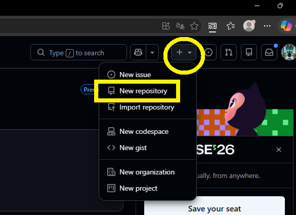
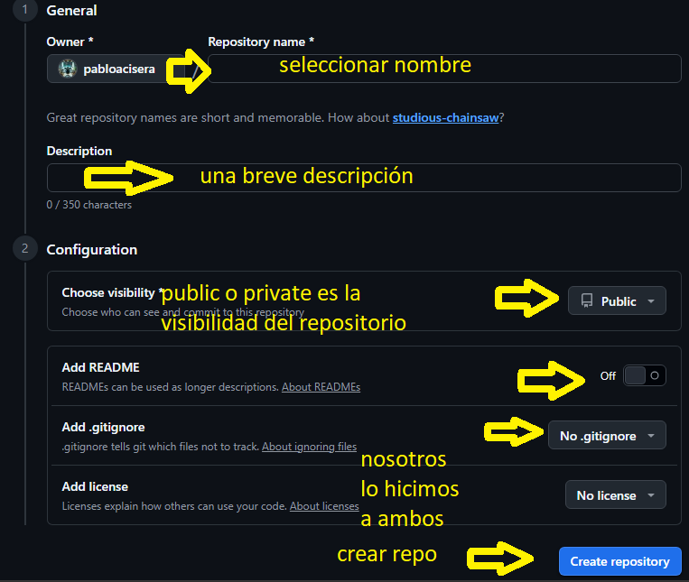
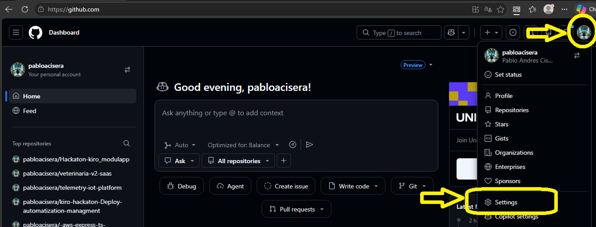
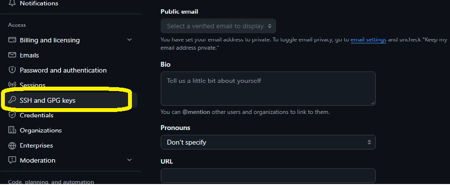
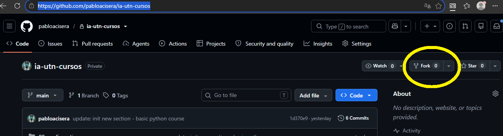

# ¿Que es Github?

Github es una plataforma en la nube(un servicio de alojamiento de datos) construido sobre git. Si GIT es la herramienta que no permite un sistema de trazabilidad de cambios locamente, entonces github es donde guardas, compartes y colaboras en esos proyectos.

### Utilidad:

Sirve como si fuera un "Google Drive" o "Dropbox" especializado para programadores. Al hacer `git push` en un terminal subes todo tu proyecto a Github, asegurando que no se pierda, y que pueda ser accesible desde otras computadoras.

Sirve para trabajo colaborativo. Cuando varias personas deben trabajar sobre un mismo proyecto:
- `Fork`: crear un version propia de un proyecto ajeno.
- `Pull Request`(PR): El dueño del proyecto puede mergear nuestros cambios

Sirve para portafolio personal y perfil profesional. Muestra tus proyectos personales, tus trabajo previos, la documentación importante, las tecnologias que dominas, las contribuciones a otros proyectos, la actividad diaria.

Sirve para automatización y despligue. La plataforma nos ofrece dos servicios a estos fines:
- Github Pages: para almacenar de manera gratuita paginas o aplicaciones web estaticas(sin backend)
- Github Actions: para ejecutar una acción cada vez que se suba un cambio(ejemplo: pruebas automaticas o testeo del codigo)

Sirve para organizar el trabajo y reportar errores. Ofrece tableros tipo kanban e issues para informas de errores que deben ser resueltos.

### Creacion de cuenta en Github

Nos dirigimos a la página `https://github.com` y le hacemos click al boton `Sign In`

Una vez que hayamos creado el perfil procederemos a forkear el repositorio del curso:

`https://github.com/pabloacisera/ia-utn-cursos`

> 🔄 **Diferencia entre Forkear y Clonar:**
>
> * **Clonar (`git clone`):** Descarga una copia exacta de un repositorio directamente en tu dispositivo local. **Ojo:** Esto no te otorga permisos de escritura en el proyecto original automáticamente. Si clonás un repositorio ajeno y hacés un `git push`, GitHub bloqueará el acceso por seguridad, a menos que el dueño te haya configurado explícitamente como colaborador. Si el proyecto es tuyo (o tenés permisos), los pushes sí modificarán el repositorio original.
>
> * **Forkear (Fork):** Crea una copia exacta de un repositorio ajeno, pero **dentro de tu propio perfil de GitHub** (en la nube). Esto te da control absoluto de esa copia para experimentar. Los cambios que pushees en tu Fork no afectarán jamás al repositorio original. Sin embargo, el vínculo no se rompe del todo: GitHub mantiene la conexión para que, si lo deseas, puedas proponer tus mejoras al autor original a través de un *Pull Request*.

---

## Crear un repositorio

Crear un repositorio es crear una espacio de almacenamiento el cual podra ser clonado en nuestro dispositivo, y podrá ser manipulado tanto local como remotamente. 

- En la parte superior derecha encontramos el boton para crear un nuevo repositorio

- Se abrira el formulario de creacion de repositorios

## Clonar un repositorio

Para que el sistema nos permita clonar, debemos primero crear par de llaves con `ssh-keygen`, debemos alojarla en la sección de Github correspondiente:

Vamos a buscar la seccion `SSH and GPG Keys`

En la parte superior derecha hay un boton `New SSH Key`, esto abrira un modal con un formulario que nos pedirá un titulo o descripción y la llave.

> RECORDATORIO: la llave publica la podemos ver mediante el comando:

`cat ~/.ssh/id_ed25519.pub`

## Forkear un repositorio

Obtenemos la url del repositorio del curso:

`https://github.com/pabloacisera/ia-utn-cursos`

En la parte superior encontramos el boton de forkeo:

Esto creará una copia con el mismo nombre en tu repositorio personal, el cual esta listo para ser clonado en tu dispositivo