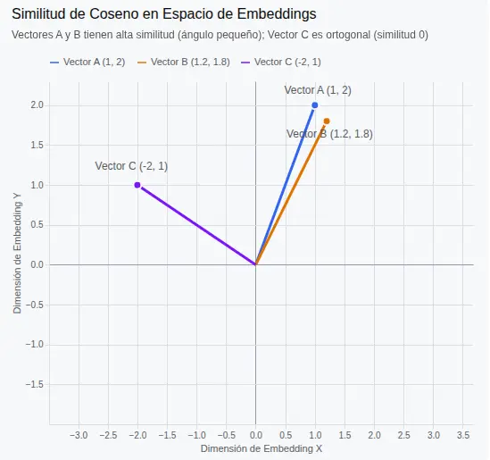
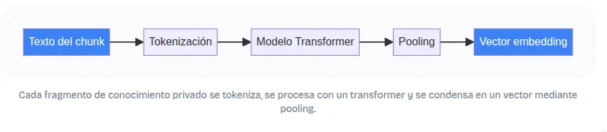

## ¿Que es un embeddings?

Imagina que cada fragmento de tus documentos privados —políticas internas, manuales técnicos, informes financieros— pudiera colocarse en un mapa gigante donde los temas similares quedan automáticamente cerca. Ese mapa no se dibuja con calles, sino con números. Cada punto es un vector, una lista de cientos de números que capturan la esencia semántica del texto. Así funcionan los embeddings: la pieza que permite a un sistema RAG recuperar el contexto adecuado aunque la consulta use palabras distintas a las del documento original.

En la unidad anterior aprendiste a fragmentar documentos en chunks. Ahora esos fragmentos necesitan una representación numérica para que el motor de búsqueda pueda comparar significados, no solo palabras.

Mientras que una lista cualquiera de números no tiene por qué guardar relación con el contenido, un embedding sitúa conceptos afines cerca unos de otros.

Entonces: es el proceso por el cual el significado del texto se convierte en una coordenada o representación numérica.

Su utilidad radíca en la posibilidad de comparar embedding a travéz la similitud de coseno.

*Similitud de coseno es una métrica que mide qué tan parecidos son dos embeddings calculando el ángulo entre ello.*

- Similitud = 1 (Ángulo de 0°): Las dos flechas apuntan exactamente en la misma dirección. Los textos tienen significados casi idénticos (ej. "Hola, ¿cómo estás?" y "Buenas, ¿qué tal?").
- Similitud = 0 (Ángulo de 90°): Las flechas son perpendiculares. No hay ninguna relación entre los textos (ej. "El desarrollo de software" y "La receta de la pizza").
- Similitud = -1 (Ángulo de 180°): Las flechas apuntan en direcciones opuestas. Son conceptos totalmente contrarios (aunque en procesamiento de texto con IA, los resultados suelen oscilar más bien entre 0 y 1).

Otra cosa importante a tener en cuenta es ¿que será objeto de embeddings?, ¿serán palabras, frases u oraciones?.

Para ejecutar estos embeddings existen modelos especificos, cuyo unico objetivo o finalidad es entender el contexto de un contenido.

Piensa en las palabras “rey” y “reina”. En un espacio de embeddings bien entrenado, sus vectores aparecen próximos porque comparten el contexto de la realeza. En cambio, “rey” y “lavavajillas” quedan muy distantes(No importan las palabras importan sus contenidos).

*Flujo desde chunks hasta embedding*:

Una vez que todos los chunks están representados como vectores, la relevancia de un documento para una consulta se calcula con funciones de distancia. Las dos métricas más utilizadas son la distancia euclidiana (la longitud del segmento recto que une dos puntos) y la similitud del coseno (el ángulo entre los vectores). La similitud del coseno es especialmente popular en tareas de recuperación porque normaliza la longitud de los documentos: ignora la magnitud y se centra en la orientación, evitando que los textos más largos dominen la comparación.

En la práctica, el motor de recuperación del sistema RAG calcula el coseno entre el vector de la pregunta y los vectores de todos los fragmentos indexados, y devuelve aquellos con mayor puntuación. Esta capacidad de comparación numérica transforma una necesidad de información expresada en lenguaje natural en una operación matemática eficiente sobre la base de conocimiento privado.

Para la practica podemos usar un modelo de embedding del mismo proveedor groq que venimos usando, se llama `nomic-embed-text-v1_5`, soporta hasta 8195 tokens, o sea, es ideal para texto extensos y ademas genera un vector de 768 dimensiones.

> Importante: Si la información es privada, y por cuestiones legales o de decisión no puede salir del ambito local, no podemos usar api como la de groq u openai, podemos usar BGE-M3(transformadores con BERT) o Cohere embed-v4 que soporte español, pero la mejor version en local es `nomic-embed v2`, PERO NO ES MULTILINGUE.

[Practica de embeddings sobre un documento de estructura compleja](../../../Practicas/RAG/02-con-langchain/segmentation_embed.ipynb)

Si bien el codigo anterior **ha funcionado**, no es aplicable a producción o a un sistema profesional, por lo siguientes motivos:

1. Desbordamiento de memoria RAM (OOM): pdf2image convierte todas las páginas del PDF en imágenes PIL de alta resolución simultáneamente antes de empezar. En un documento grande, esto satura la memoria de la PC.

2. Cuellos de botella y Rate Limits (API): Hacer un bucle sincrónico enviando imagen por imagen a una API externa (como Groq) satura los límites de peticiones por minuto (RPM) y vuelve el proceso extremadamente lento.

3. Micro-fragmentación inútil (max_tokens=30): Con un límite tan bajo, un documento de 100 páginas generará miles de fragmentos microscópicos que pierden el contexto global y confunden al modelo de embeddings.

4. Cortes en saltos de página: Si un párrafo conceptual importante arranca al final de la página 3 y termina al principio de la página 4, el script actual lo corta abruptamente al cambiar de imagen.

*Solución*:

1. Extracción Híbrida (Texto Nativo + Visión Selectiva)
El problema del modelo actual: Envía cada página como imagen a la API de visión, incluso si es solo texto plano aburrido. Eso es costoso y lento.

La solución: Usar una librería ligera y gratuita como pdfplumber o PyMuPDF (fitz) para extraer el texto plano de forma instantánea.

¿Cuándo usar visión? Solo disparar el modelo de visión (o un modelo local si se prefiere) cuando el script detecte que una página tiene tablas complejas, gráficos o esquemas que el texto plano no puede leer.

2. Procesamiento por lotes (Generadores / Lazy Loading)
En lugar de cargar todo el PDF a la RAM de un golpe con pdf2image, se procesa página por página o en rangos pequeños utilizando un generador, liberando memoria al instante.

3. Ajuste realista del tamaño de los Chunks
Elevar el max_tokens a un tamaño útil para recuperación semántica real (por ejemplo, entre 350 y 500 tokens) con un overlap del 10% (unos 40 o 50 tokens), para que los fragmentos tengan verdadero sentido contextual.
