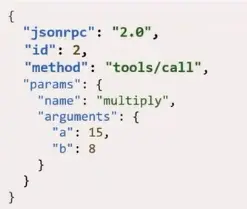
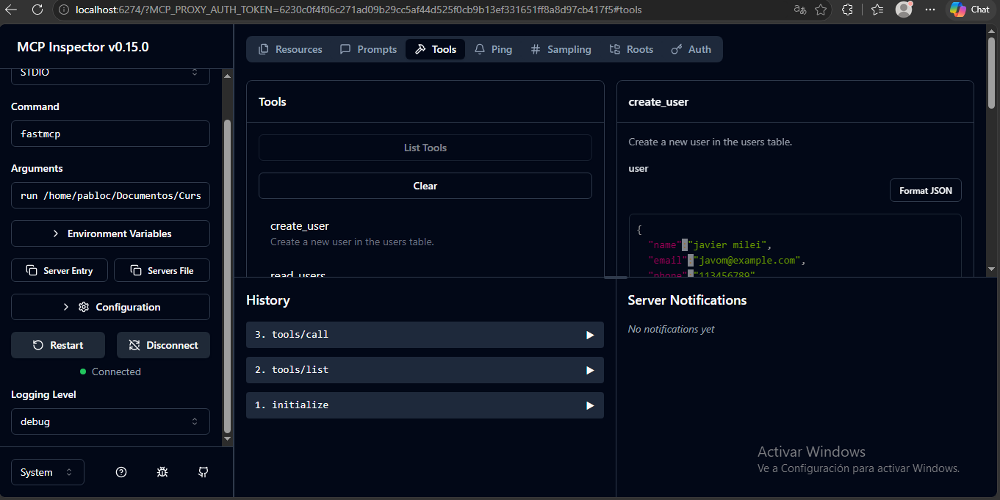

# Model Context Protocol

1. [Concepto](#concepto)
2. [Core del MCP](#core-del-mcp-host-clients-servers-primitives)
    - [Ciclo de vida de un MCP](#ciclo-de-vida-de-un-mcp)
    - [¿Por qué se usa JSON-RPC 2.0?](#por-qué-se-usa-json-rpc-20)
3. [Implementación en un agente](#implementación-en-un-agente)
4. [Ejemplo en el mundo real](#ejemplo-en-el-mundo-real)

### Concepto

Es un protocolo creado por Anthropic que estandariza cómo un agente se conecta con herramientas o fuentes externas. Ofrece una interfaz universal para realizar esta integración de manera segura. Bajo la idea de estandarización, la premisa es que cualquier cliente que cumpla con ciertos requisitos puede conectarse a cualquier servidor que soporte este protocolo.

Para entender el problema que resuelve debemos remontarnos a la arquitectura previa a su existencia: para que un modelo pudiera acceder a una herramienta o información de un servicio, debía utilizar un SDK o una API específica del proveedor, adaptándose obligatoriamente a sus estándares y métodos individuales. Esto provocaba que, al requerir múltiples servicios, existieran múltiples interfaces con requisitos diferentes, complicando drásticamente el desarrollo y mantenimiento de cada conexión.

Con MCP, esta complejidad se elimina mediante una arquitectura desacoplada donde existen clientes que se conectan de manera homogénea a servidores MCP encargados de exponer las conexiones.

### Core del MCP (host, clients, servers, primitives)

Existen varias capas y conceptos clave que permiten entender el funcionamiento interno de un MCP:

1. **Host:** Es la aplicación de IA principal con la que interactúa el usuario final (por ejemplo, Claude Desktop, Cursor, VS Code, etc.). El Host actúa como el contenedor y coordinador principal; se encarga de gestionar la seguridad, las autorizaciones de usuario y la integración final con el LLM.
2. **Client:** Son componentes creados e instanciados por el Host. Cada cliente mantiene una conexión directa y aislada en una **relación estricta 1:1 con un servidor específico** (un cliente dedicado para GitHub, un cliente dedicado para Slack). Se encargan de traducir los mensajes de forma bidireccional.
3. **Server:** Son programas ligeros e independientes que exponen de forma segura los recursos, herramientas o flujos de trabajo que el LLM necesita. Operan de forma aislada y no conocen el historial de la conversación ni la existencia de otros servidores en el ecosistema.
4. **Primitives (Primitivas):** Son las capacidades estándar que los servidores exponen a los clientes, divididas en tres tipos fundamentales:
   * **Resources:** Fuentes de datos e información legibles por el modelo (como archivos locales, textos de logs o respuestas estáticas de APIs).
   * **Tools:** Funciones ejecutables con efectos secundarios que el modelo puede decidir invocar (como compilar código, crear un archivo o consumir un endpoint externo).
   * **Prompts:** Plantillas predefinidas de instrucciones reutilizables que ayudan a guiar al modelo en tareas y flujos comunes.


> 💡 **Nota sobre el transporte:** La comunicación entre cliente y servidor se realiza mediante el estándar JSON-RPC 2.0. Estos servidores pueden correr localmente (comunicándose mediante `stdio`) o de manera remota (utilizando Server-Sent Events - `SSE` sobre HTTP), y pueden ser de desarrollo propio o pertenecer a un tercero.

> 🔀 **Flujo de orquestación:** Ningún servidor interactúa con otro directamente, ni un solo cliente se conecta a múltiples servidores en paralelo. Es el **Host** el encargado de gestionar múltiples instancias de clientes simultáneamente. Si el LLM necesita resolver una tarea compleja multiplataforma, el **Host** coordinará de forma secuencial las peticiones a través de sus respectivos clientes: primero solicitará datos al cliente del repositorio Git, procesará el contexto obtenido, luego instruirá al cliente de Supabase para actualizar la base de datos y finalmente usará el cliente de Slack para notificar la actualización.

### Ciclo de vida de un MCP

Las sesiones MCP son persistentes y con estado, desarrollándose a través de cuatro fases estrictas:

*   **Inicialización (Handshake):** El cliente inicia la sesión enviando un mensaje `initialize` que contiene la versión del protocolo (JSON-RPC 2.0) y sus capacidades de cliente (como *roots* para delimitar accesos o *sampling* para permitir que el servidor le pida generaciones al LLM). El servidor responde confirmando la compatibilidad y compartiendo sus propios metadatos. Finalmente, el cliente envía una notificación de `initialized` para dar luz verde a la sesión.
*   **Descubrimiento (Discovery):** Una vez abierta la sesión, el host solicita al servidor su listado de capacidades a través de esquemas estructurados. El servidor expone qué *Tools*, *Resources* y *Prompts* tiene a disposición (por ejemplo: *"Tengo disponibles métodos de Git: init, commit, add, pull y push"*). Funciona bajo un concepto similar a los esquemas de herramientas (Tools) de frameworks como LangChain.
*   **Operación (Active Session):** Es el flujo dinámico de trabajo. Cuando el LLM analiza la consulta del usuario y determina que requiere una herramienta externa, el **Host** toma esa decisión y le ordena al **Cliente** enviar una solicitud formal de ejecución. El **Servidor** procesa la lógica nativa del sistema, aplica los controles de seguridad y devuelve los datos estructurados al cliente para integrarlos de vuelta al contexto del modelo.
*   **Cierre (Shutdown):** Los canales de comunicación **permanecen abiertos y activos** durante toda la vida útil de la sesión para soportar interacciones continuas o streaming de logs. El cierre no ocurre por cada operación individual; se ejecuta de forma ordenada mediante una solicitud de `shutdown` y un mensaje de `exit` únicamente cuando el Host termina la tarea global, el usuario cierra la aplicación o expira un tiempo de espera, liberando así los procesos de memoria (`stdio` o conexiones `SSE`).

### ¿Por qué se usa JSON-RPC 2.0?

Representa y las trasferencia de información estructurada, a diferencia de una api rest que puede ser implementada de muchas maneras



> Host request -> server


> Server result -> host

Cuando el servidor mcp es local(proceso secundario en la misma maquina), el estandar de comunicacón es stdin/stdout. Si el servidor es remoto, usamos SHT(Streameable HTTP Transport, la conexión se da mediante un metodo post y el descubrimiento mediante SSE streaming). Ambos sistema usan el mismo protocolp JSON-RPC, asi que podemos usar cualquiera de las dos capa de transporte.

*Practica 1*

Elaboración de un conjunto de métodos que nos ayuden a ver, crear, modificar o eliminar usuarios de una base de datos. A los fines de velocidad y practicidad utilizaremos sqlite, pero si el alumno conoce otros motores esta invitado a usarlos y experimentar.

```Python
# sqlite3: lightweight local database module
import sqlite3

# typing: native python library to establish complex types
# List: expected variable or output type is a list
# Optional: helps define an implicit None value
from typing import List, Optional

# pydantic: external library for data validation and settings management
from pydantic import BaseModel, Field

# fastmcp: allows creating a python server for our MCP
from fastmcp import FastMCP


# Initialize application and assign a name
my_mcp = FastMCP("mcp:sqlite-user-crud")

# Set the database file name
db_name = "mcp-test-db.db"

# Create a function to initialize the database if it doesn't exist
def init_db():
    """Create database if it does not exist when the server initializes."""
    # Start context manager
    with sqlite3.connect(db_name) as conn:
        # connect returns the connection object to create the intermediary (cursor)
        cursor = conn.cursor()

        # Execute table creation
        cursor.execute("""
                        CREATE TABLE IF NOT EXISTS users(
                            id INTEGER PRIMARY KEY AUTOINCREMENT,
                            name TEXT NOT NULL,
                            email TEXT NOT NULL,
                            phone TEXT
                        )
                       """)
        conn.commit()

# Run database initialization
init_db()


# Schema validation (data structures)

class UserCreate(BaseModel):
    name: str = Field(..., description="The user's full name")
    email: str = Field(..., description="The user's email address")
    phone: Optional[str] = Field(None, description="The user's phone number")

class UserUpdate(BaseModel):
    name: Optional[str] = Field(None, description="The user's full name")
    email: Optional[str] = Field(None, description="The user's email address")
    phone: Optional[str] = Field(None, description="The user's phone number")


# MCP Tool Creation

@my_mcp.tool()
def create_user(user: UserCreate) -> str:
    """Create a new user in the users table."""
    try:
        with sqlite3.connect(db_name) as conn:
            cursor = conn.cursor()
            # Pass the values securely as a tuple in the second argument of execute()
            cursor.execute(
                "INSERT INTO users(name, email, phone) VALUES(?, ?, ?)",
                (user.name, user.email, user.phone)
            )
            conn.commit()
            return f"User successfully created. Assigned ID: {cursor.lastrowid}"
    except sqlite3.IntegrityError as e:
        return f"Error creating user: {str(e)}"


@my_mcp.tool()
def read_users() -> str:
    """Read all users from the database."""
    # Change presentation settings; by default, connection returns tuples like ("john", 25)
    # Using row_factory converts it into a dict-like object to access columns by name
    # This prevents us from needing to know the exact index position
    with sqlite3.connect(db_name) as conn:
        conn.row_factory = sqlite3.Row

        cursor = conn.cursor()
        cursor.execute("SELECT * FROM users;")

        rows = cursor.fetchall()

        if not rows:
            return "No users found in the database."

        results: List[str] = []
        for row in rows:
            results.append(f"ID: {row['id']} | Name: {row['name']} | Email: {row['email']} | Phone: {row['phone']}")
        return "\n".join(results)


@my_mcp.tool()
def update_user(user_id: int, new_data: UserUpdate) -> str:
    """Update fields of an existing user found by their ID."""
    # model_dump converts the Pydantic object into a dictionary
    # exclude_unset=True ignores fields that were not sent for update
    row_to_update = new_data.model_dump(exclude_unset=True)

    if not row_to_update:
        return "No fields were provided for update."

    # Added a trailing space to prevent SQL syntax errors
    query = "UPDATE users SET " + ", ".join([f"{k} = ?" for k in row_to_update.keys()]) + " WHERE id = ?"

    # Critical fix: Appended the user_id to the values list to match the WHERE clause placeholder
    values = list(row_to_update.values()) + [user_id]

    with sqlite3.connect(db_name) as conn:
        cursor = conn.cursor()
        cursor.execute(query, values)
        conn.commit()

        if cursor.rowcount == 0:
            return f"No user found with ID: {user_id}"

    return f"User with ID = {user_id} successfully updated."


@my_mcp.tool()
def delete_user(user_id: int) -> str:
    """Permanently delete a user from the database by their ID."""
    # Fixed the table name from 'usuarios' to 'users'
    with sqlite3.connect(db_name) as conn:
        cursor = conn.cursor()
        cursor.execute("DELETE FROM users WHERE id = ?", (user_id,))
        conn.commit()

        if cursor.rowcount == 0:
            return f"No user found with ID {user_id}."
        return f"User with ID {user_id} successfully deleted."


if __name__ == "__main__":
    my_mcp.run()

```
Para verificar que la practica fue correcta, y que las tools seran reconocidas, fastmcp trae una herramienta nativa llamada "inspector" que levanta una interfaz web que nos permite ejecutar las herramientas, y testear si su funcionamiento es el esperado.

``fastmcp dev inspector ruta\al\archivo.py:<nombre-del-mcp>``

> Debemos asegurarnos de que tenemos instalado node en version 20 o inferior. Node es un runtime o entorno de ejecucion de javascript, y es la herramienta que nos permite levantar un servidor y visualizar aplicación web. Para ello en el entorno correspondiente ejecutamos `sudo apt install node.js`. Si ya tenemos instalado una version superior, instalamos el node version manager(nvm) y usamos la version 18. `https://nodejs.org`

```bash
curl -o- https://raw.githubusercontent.com/nvm-sh/nvm/v0.40.7/install.sh | bash

cat << 'EOF' >> ~/.bashrc

# Configuración permanente de NVM
export NVM_DIR="$HOME/.nvm"
[ -s "$NVM_DIR/nvm.sh" ] && \. "$NVM_DIR/nvm.sh"
[ -s "$NVM_DIR/bash_completion" ] && \. "$NVM_DIR/bash_completion"
EOF

nvm install 18

node -v

npm -v
```
> Se pueden investigar otros gestores mas rapidos como fnm(rust) o volta(rust) ambos nativos en wsl1

Una vez que hayamos podido ingresar a la web de prueba, hacemos click en "Connect"(puede tardar segun velocidad de proecesador y memoria), cuando marque conectado vamos a la pestaña tools > list tools, y veremos las herramientas que el mcp identifico.

