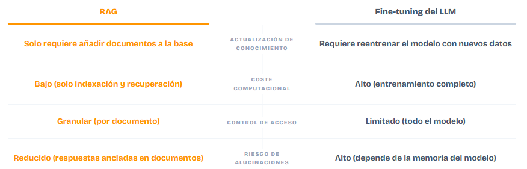
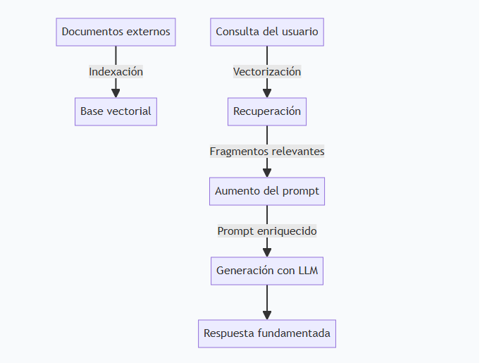

# 12. RAG: conocimiento privado y memoria

> **Objetivo:** entender qué es RAG, cómo funciona su flujo, cómo se construye y cómo resuelve dos problemas centrales: darle al modelo **datos privados** que nunca vio y una **memoria a largo plazo** que persiste entre consultas.

## El problema

Un LLM está entrenado con texto público y "congelado" en el tiempo. No conoce los documentos de tu empresa, tus apuntes ni lo que pasó ayer. Si le preguntás por eso, **alucina** (Módulo 10).

Reentrenar el modelo con esos datos es carísimo, lento y hay que repetirlo cada vez que cambia un documento. RAG evita todo eso.

## Qué es RAG

**RAG** (*Retrieval-Augmented Generation*, generación aumentada por recuperación) **no es un modelo**: es una **arquitectura** que combina dos piezas.

1. Un **sistema de recuperación de información** (busca los fragmentos relevantes).
2. Un **LLM** (redacta la respuesta usando esos fragmentos).

La idea, en una frase: **en vez de meter los datos dentro del modelo, le pasamos los fragmentos correctos en el momento de la consulta.**

### Por qué conviene frente a otras opciones

- **Es más barato y rápido** que reentrenar.
- **Se actualiza** con solo cambiar los documentos indexados.
- **Reduce las alucinaciones**, porque la respuesta se apoya en fuentes concretas.

> En este curso **no** hacemos fine-tuning ni entrenamiento. Solo RAG.

## El flujo de un RAG

Un RAG no es un monolito: son **dos tuberías**.

### A. Tubería de indexación (offline)

Se ejecuta una vez (y se repite cuando cambian los documentos). No interviene el usuario y no afecta la velocidad de respuesta.

1. **Fragmentación (chunking):** partir los documentos en trozos.
2. **Conversión a vectores (embeddings):** cada trozo → un vector (Módulo 11).
3. **Almacenamiento** en una base de datos vectorial.

### B. Tubería de consulta (en tiempo real)

Responde cada pregunta del usuario:

1. La **pregunta** se convierte en un vector (con el **mismo** modelo de embeddings).
2. **Búsqueda por similitud:** se recuperan los fragmentos más parecidos (**top-k**).
3. **Aumento del prompt:** los fragmentos recuperados se agregan a la pregunta.
4. El **LLM genera** la respuesta usando ese contexto.

## De documentos a fragmentos

- Los documentos llegan en distintos formatos (PDF, DOCX, planillas…). Primero se pasan a **texto plano** y se les agrega **metadatos** (título, autor, fecha de edición…).
- Luego se **fragmenta** el texto. Criterios habituales:
  - por **tamaño fijo** (por ejemplo, N caracteres),
  - por **párrafo**, o
  - **semántico** (cortar donde cambia la idea).
  - En la práctica se combinan más de uno.

> **Por qué importa el tamaño:** trozos muy chicos pierden contexto; trozos muy grandes meten ruido y cuestan más tokens. Es una decisión de diseño.

## De texto a número

Cada fragmento se convierte en un **embedding** de alta dimensionalidad (por ejemplo, 768 números) que captura **significado**, no solo palabras clave.

- Para que la comparación tenga sentido, la **pregunta** se convierte con el **mismo** modelo de embeddings que los documentos.
- Si se usan modelos distintos, las similitudes no significan nada y la recuperación falla.

Una analogía útil: cada fragmento es una foto y su embedding es la **huella digital**; la pregunta es otra huella y buscamos las más parecidas.

## La base de datos vectorial

Los embeddings se guardan en una **base de datos vectorial** (por ejemplo `faiss`, `chroma`, `pgvector`), que hace búsquedas **ANN** (aproximadas) entre vecinos cercanos, muy rápido aunque haya millones de vectores (`top-k`).

Junto al vector se guarda **el texto original y sus metadatos**: el vector es la "huella" para buscar, el texto es lo que efectivamente se recupera.

> Detalle de almacenamiento: 10 000 vectores de 384 dimensiones de 4 bytes ocupan ~15 MB.

## El motor de recuperación

- La **distancia de coseno** (o el producto punto, con vectores normalizados) mide el parecido. Los mejores candidatos son el **top-k**.
- Además de la búsqueda vectorial existen las **búsquedas híbridas** (por palabra clave, como **BM25**), que conviene combinar: la semántica captura el sentido, la palabra clave captura nombres y términos exactos.

## El aumento del prompt

Se le pasan al LLM **el fragmento recuperado + la pregunta original**, con una instrucción que acota el contexto:

> *"Responde únicamente con la información proporcionada. Si no encuentras la respuesta, indica que no dispones de esa información."*

Esta etapa es la que **más latencia** introduce, por eso se aplican límites y optimizaciones.

> **Orquestación:** la lógica que une recuperación y generación se puede escribir a mano (como hacemos acá). Más adelante, en el **Módulo 13**, veremos que un framework como **LangChain** simplifica esa unión; pero el RAG en sí no depende de ningún framework.

## Cómo da memoria a largo plazo

El LLM no recuerda nada entre llamadas (Módulo 10). RAG resuelve la memoria **persistente** así:

- Todo lo que querés que el sistema "recuerde" se **guarda** (como texto) y se **indexa** en la base vectorial.
- En cada consulta se **recupera** lo relevante y se le entrega al modelo en el prompt.
- Resultado: el sistema "recuerda" aunque el modelo, por dentro, siga sin memoria.

Es el mismo mecanismo que resuelve los **datos privados**: si está indexado, el modelo puede usarlo, sin haber sido entrenado con ello.

## Ejercicios

- [01 — Diseccionar el flujo de un RAG](./ejercicios/01-flujo-rag.md)
- [02 — Chunking: fragmentar un documento](./ejercicios/02-chunking.md)
- [03 — De fragmentos a vectores y búsqueda](./ejercicios/03-busqueda-vectorial.md)

[Menu Principal](../../README.md) | [Anterior: Funcionamiento interno](../Funcionamiento-Interno/readme.md) | [Siguiente: LangChain](../LangChain/readme.md)
