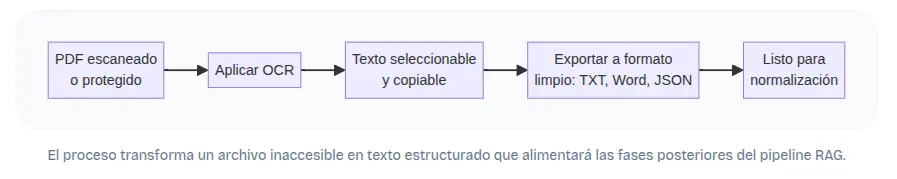

## Preparación de Documentos

Existen documentos de texto plano o con formato especifico que pueden ser leidos por la librería nativa de python(Open), pero otro documentos, con formatos particulares como pdf, como excel, o incluso documentación que esta una imagen o en una diapositiva.

Algunos de estos documentos ni siquiera se dejan seleccionar, lo que dificulta la estracción del contenido, encontramos archivo obtenidos desde scanners o protegidos contra copias. Para obtener esa información, y que el RAG pueda conocerla, entonces utilizamos además sistema de extracción de texto con OCR(Reconocimineto Optico de Carácteres) para el supuesto donde el pdf sea una imagen.

Entonces vamos a partir el trabajo desde la extracción de texto desde un pdf, que es una de los formatos mas comunes.

*Flujo de preparación de documentos pdf*

### OCR: traductor de pixeles a texto

OCR significa "Optical character recognition", reconoce un carácter en una imagen y lo convierte en un carácter de tipo computacional, codificado.

Smallpdf ofrece OCR, aunque con una limitación: no está habilitado para procesamiento en grupo. Si necesitas extraer texto de muchos archivos, la estrategia recomendada es unirlos primero en un solo PDF y luego aplicar OCR al documento combinado.

### Transformacion

Una vez extraído el texto, el formato de salida condiciona la facilidad con que podrás limpiarlo y estructurarlo después. No es lo mismo un bloque de texto plano que un archivo que conserve cierta organización visual. Las herramientas ofrecen varias opciones:

TXT: texto plano compatible universalmente, ideal para máxima simplicidad y procesamiento automático.
Word/RTF: documento editable en Microsoft Word, Google Docs o LibreOffice, que conserva cierta estructura visual y es útil si necesitas revisar manualmente el contenido.
JSON: datos estructurados para uso programático, perfecto para integraciones automatizadas en pipelines de ingesta.
Smallpdf añade la posibilidad de convertir directamente a PowerPoint o Excel, transfiriendo no solo el texto sino también imágenes y tablas.

### El problema de la privacidad

Cuando trabajas con documentos privados, la seguridad no es negociable. Las herramientas de extracción abordan este desafío con dos estrategias complementarias. Por un lado, el procesamiento completamente en el lado del cliente: el extractor de Utiltica realiza toda la extracción directamente en el navegador, de modo que los archivos PDF nunca abandonan el dispositivo del usuario, garantizando una privacidad absoluta.

Por otro lado, los servicios en la nube aplican medidas rigurosas. iLovePDF utiliza cifrado de extremo a extremo y elimina automáticamente cualquier documento subido después de 2 horas, con servidores protegidos bajo la legislación europea. Smallpdf emplea cifrado TLS de grado militar durante la carga, transferencia y descarga, y elimina los archivos tras una hora de procesamiento; además, ofrece una herramienta offline que procesa los archivos en el disco local sin subirlos a ningún servidor

### Selección inteligente

Los documentos extensos suelen contener cientos de páginas, pero no todas son relevantes. El extractor de Utiltica permite elegir páginas específicas o rangos, evitando la inclusión de portadas, índices o anexos que introducirían ruido en la base de conocimiento y afectarían la calidad de las respuestas del sistema RAG.

# Pipeline Injestion

[Aplicación para extraer información](./exercises/0_extraction_text.py)
