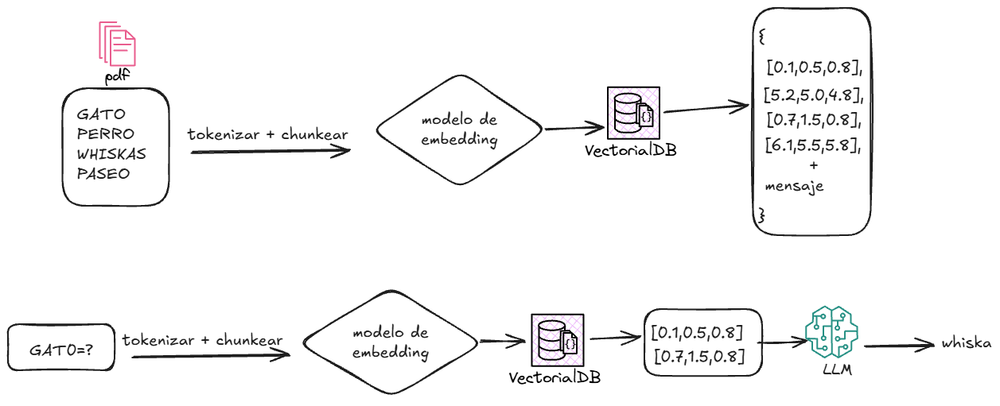
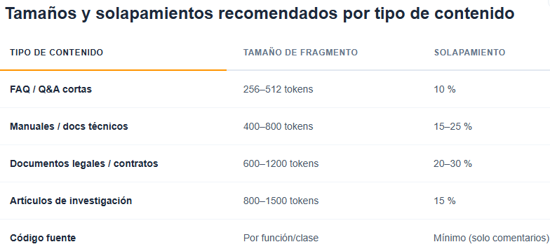
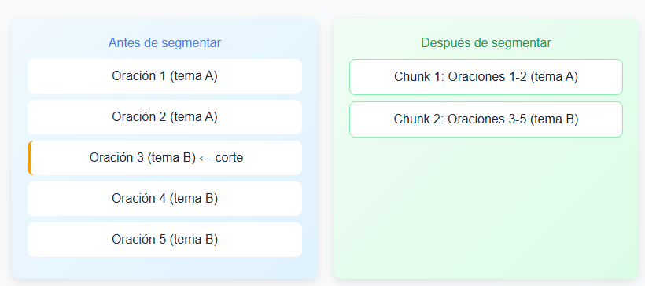

# Conceptos Fundamentales de LLMs y RAG

## 🧱 Conceptos Fundamentales

* **¿Qué es un Token?**
  Es la **unidad básica de información que procesa un LLM**. No equivale exactamente a una palabra; un token puede ser una palabra entera, una parte de ella (sílaba), un solo carácter o incluso un signo de puntuación. Como regla general, en inglés 100 palabras equivalen a unos 75 tokens, mientras que en español se suelen requerir más tokens para la misma cantidad de texto debido a la estructura del idioma. Los modelos de lenguaje no leen texto como los humanos, sino que lo fragmentan en estos bloques para poder realizar cálculos probabilísticos.

* **¿Qué es un Embedding?**
  Es la **representación matemática (vectorial) del significado de un texto**. Consiste en una lista fija de cientos o miles de números que ubica el fragmento de texto en un espacio multidimensional. Lo fundamental de los embeddings es que los textos con significados o conceptos similares quedan posicionados geométricamente cerca unos de otros. Esto permite que el sistema pueda "entender" y comparar el contexto semántico de las frases o documentos sin depender de coincidencias exactas de palabras clave.

---

## 📂 ¿Qué es la segmentación de documentos (*Chunking*) y para qué sirve?

Los LLM tienen una ventana de contexto, que es la cantidad máxima de tokens que pueden procesar en una sola interacción antes de perder el hilo conductor de una conversación. Aunque las ventanas actuales admiten cientos de miles de tokens y permitirían cargar un documento entero directamente en el sistema, hacer esto genera graves ineficiencias técnicas.

Si un documento de 50 páginas trata múltiples temas y se procesa como un único bloque para generar un solo embedding, la representación matemática se satura y pierde resolución semántica. Como consecuencia, al realizar una búsqueda vectorial, el sistema recuperará un bloque masivo de información irrelevante, provocando que la respuesta del LLM sea vaga, difusa o incompleta (fenómeno conocido como *Lost in the Middle*).

La solución a esto es el **chunking** o segmentación. Consiste en dividir el documento en fragmentos más pequeños y significativos, donde **cada segmento genera su propio embedding**. Esto permite que la búsqueda vectorial localice con precisión matemática el fragmento exacto que responde a la consulta del usuario.

Sin embargo, el diseño de la segmentación tiene un lado crítico:
* **Segmentación excesiva (Chunks muy pequeños):** Se pierde el contexto global de la idea y las conexiones lógicas, haciendo que el LLM reciba información incompleta.
* **Segmentación insuficiente (Chunks muy grandes):** Se diluye la precisión de la búsqueda semántica y se satura la ventana de contexto consumiendo una mayor cantidad de tokens innecesarios.

**En conclusión:** El éxito de un sistema RAG (Generación Aumentada por Recuperación) radica en encontrar el equilibrio óptimo en el tamaño del *chunk* y su solapamiento (*overlap*).

*Repaso Flujo básico(ingesta/consulta)*

*Resumiendo:* La segmentación cumple dos funciones básicas, optimización en la utilización de tokens y precisión en la recuperación y contexto de la respuesta. Incluso si tu documento cabe en la ventana del modelo, segmentarlo mejora la precisión. Un fragmento de 256 tokens sobre un tema concreto siempre será más útil que un vector de 8000 tokens que intenta abarcarlo todo, además de que nos aseguramos que no perdemso contexto.

Para poder realizar esta actividad tan importante de manera efectiva se han planteado estrategias, las culaes veremos a continuación.

### Estrategias de segmentacion de tamaño fijo:

1. Segmentación de tamaño fijo: Es la estrategia mas simple consiste en dividir el documento cada N cantidad de tokens, sin atender a los limites de oraciones o parrafo. Se suelen usar herramientas como `CharacterTextSplitter`, especificando el `chunk_size` y el `chunk_overlap`.

Pero según el contenido segmentado, esto puede destruir la coherencia interna del documento. Pero si se combina con un solapamiento adecuado, y ajustando el tamaño a un dataset de 64-128 tokens o 512-1024 para preguntas con contexto amplio podemos lograr un adecuado contexto de respuesta.

>> Error: María necesita dividir un informe de ventas extenso para un sistema RAG. Usa segmentación de tamaño fijo de 300 caracteres, pero el corte parte justo la frase 'las ventas del trimestre anterior cayeron un...' dejando la información incompleta. Al recuperar ese fragmento, el sistema no entiende si hubo caída o subida.

| Método (Text Splitter) | Separador Principal | Funcionamiento Interno | ¿Cuándo usarlo? |
| :--- | :--- | :--- | :--- |
| **CharacterTextSplitter** | `"\n\n"` (o uno personalizado) | Divide el texto de forma rígida usando únicamente el separador definido. Si un fragmento se pasa del `chunk_size`, no se dividirá a menos que encuentre ese carácter exacto. | Para textos muy homogéneos o cuando quieres obligar al sistema a respetar saltos de párrafo exactos. |
| **RecursiveCharacterTextSplitter** | `["\n\n", "\n", " ", ""]` | Revisa la lista de separadores en orden de prioridad. Si el fragmento es más grande que el `chunk_size`, salta al siguiente separador de la lista para dividir el texto sin romper palabras ni oraciones. | Es la opción recomendada por defecto para la gran mayoría de textos planos, artículos y documentos genéricos. |
| **MarkdownTextSplitter** | Estructuras Markdown (`#`, `##`, `-`, etc.) | Utiliza la lógica recursiva pero añade como máxima prioridad los encabezados, listas y bloques de código propios de la sintaxis Markdown. | Para documentaciones técnicas, archivos `.md` de repositorios o notas estructuradas jerárquicamente. |
| **TokenTextSplitter** | Contador de Tokens (ej. Tiktoken o SentencePiece) | No mide la división por caracteres ni palabras, sino por la cantidad de tokens que representan. Corta el texto basándose en las reglas del tokenizador del modelo. | Crucial para optimizar el espacio exacto que ocupará el texto dentro de la ventana de contexto de un LLM específico (como GPT o Claude). |

**Cuadro de Segementacion Recomendado**

[ejercicios practicos de segmentacion fijos](./exercises/1_strategies_segmentation.py)

### Segmentación semántica

A diferencia de los métodos basados en longitud, la segmentación semántica agrupa oraciones o pasajes según su significado. Utiliza modelos de embedding para medir la similitud entre oraciones consecutivas y decide dónde cortar cuando la similitud cae por debajo de un umbral. Esto produce fragmentos temáticamente coherentes, lo que se traduce en la mayor precisión de recuperación observada en benchmarks (hasta un 70 % de mejora frente a líneas base ingenuas).

El coste computacional es más alto porque requiere incrustar y comparar múltiples segmentos. Una variante avanzada consiste en entrenar modelos de lenguaje pequeños (SLM) específicamente para encontrar puntos de ruptura óptimos. Jina AI desarrolló tres SLM para esta tarea, entre ellos simple-qwen-0.5, que segmenta basándose en la estructura del documento. La segmentación semántica es especialmente valiosa en bases de conocimiento técnico y documentos legales, donde la integridad del contexto es crítica.

*Resultado segmentación semántica*

