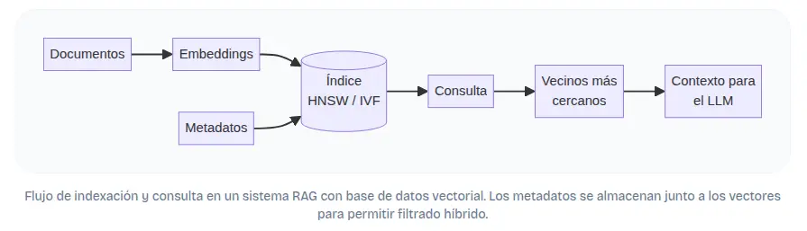
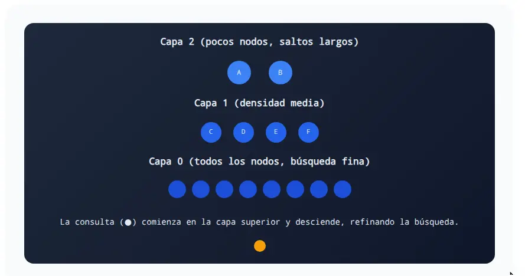
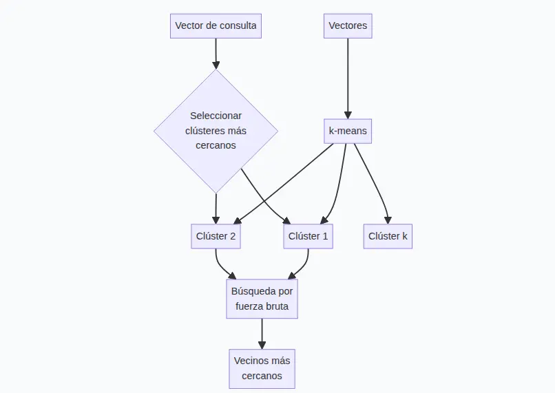
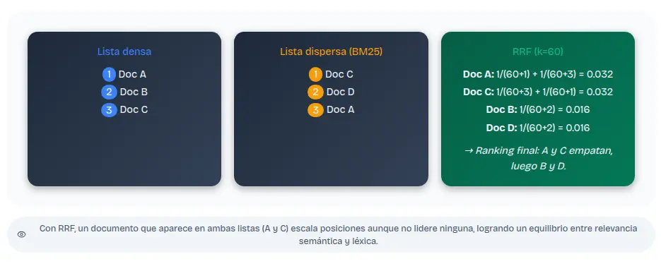
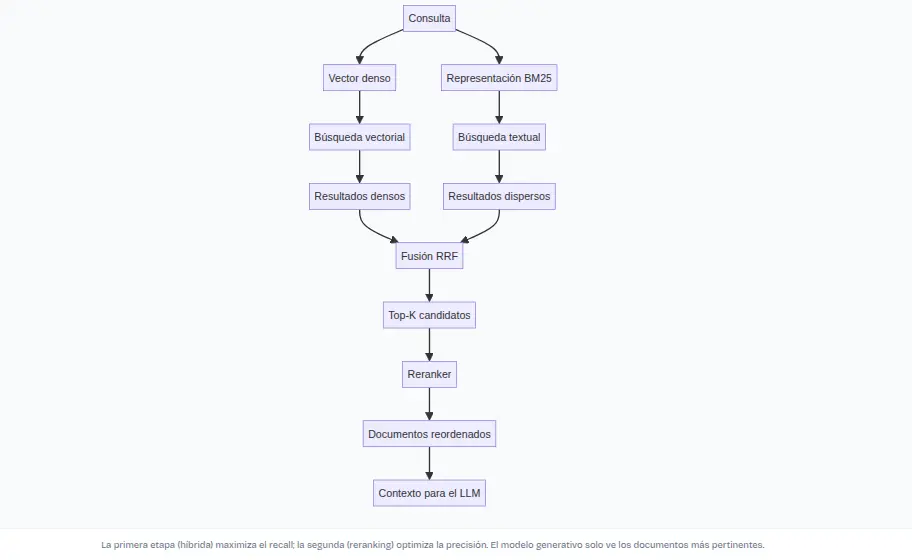

## Bases de Datos Vectoriales

Primera cuestión importante. Una bases de datos vectoriales almacena vectores, pero tambien metadatos.

La bases vectoriales son el corazon logistico de los sistemas RAG, sin ellas las busqueda serian extremadamente lentas.

Una VDB es mas que un indice vectorial como "faiss", cuya funcionalidad es buscar vecinos. Integra un indice con funcionalidades de gestion, filtrado, escalado, copias de seguridad, updates, etc.

Podemos decir que faiss es el motor, pero sin carroceria, ni frenos, ni luces, a diferencia postgres con pgvector, o qadrant, que usan algoritmos matematicos como la simulitud de coseno, la distancia euclideana, o el producto punto.

### Algoritmos ANN

Un vector no es otra cosa que una lista ordenada de numeros. El problema es que tenemos tener millones de vectores en una base de datos, como relacionamos uno o mas de ellos, en un tiempo prudencial es la cuestion a resolver.

Los algoritmos ANN reducen el campo de busqueda de vecinos, renunciando a un porcentaje de ellos o recall que se mide en lo que conocemos como decimales, o recall de 0.99 es equivalente que vamos a recuperar el 99% de los vecinos de un vector.

Existen 3 familias de algoritmos ANN:

*Grafos*(HNSW): son multicapa las exteriores son mas grandes, y la capa 0 son miles de nodos

*Clusteres*(IVF y variantes):

*Hashing*(annoy, LSH):

(falta el algoritmo lsh)

### Compresión(Cuantización)

Un vector de tipo float32 son 1536 dimensiones pesa 6kb. Si multiplicamos esto por 10millones de documents son 60gb de archivo en bruto, peso completamente inmanejable fuera de un centro de datos. Para reducir este tamaño nos apoyamos en la cuantización, que reduce ese tamaño sin sacrificar la busqueda semantica.

Tenemos 3 tipos de cuantización:

*Escalar*: mapea cada dimension a int8(1 byte u 8 bits) reduciendo 4x la misma.

*Binaria*: representa cada dimension con un solo bit, comprimiendo 32x, funciona especialmente bien para vectores de alta dimensionalidad.

*De producto*: divide cada vector en subvectores, y los asigna a un centroide de libro de codigos.

### Una alternativa rapida y automatizada:

La plataforma qdrant cloud nos brinda una instancia de base de datos vectorial, con un capa gratuta de hasta 1GB. Debemos iniciar sesión y crear un nuevo cluster con la locación mas cercana que tengamos a disposición. Esto nos va a devolver un endopint y una key, que vamos a guardar en nuestro archivo .env.

[ejercicio: conectar base vectorial, configurar y crear collección, obtener collección o borrar collección](../exercises/5_vectorial_connection.py)

## Busqueda híbrida y Reranking

La busqueda vectorial o densa pierde la precisión léxica y puede traer conceptos ajenos o innecesarios. Al mundo de busqueda de vectores vamos a agregar el BM25 y el reranking.

BM25 (Best Match 25) es un modelo probabilístico de recuperación de información que no entiende de sinónimos ni de relaciones semánticas, pero es imbatible identificando coincidencias literales. Su fórmula se apoya en tres pilares: la frecuencia inversa de documento (IDF), que da más peso a los términos raros en el corpus; la frecuencia del término en el documento, saturada mediante una función no lineal para que las palabras muy repetidas no dominen; y una normalización por la longitud del documento, que penaliza los textos excesivamente largos.

Piensa en BM25 como un bibliotecario meticuloso que recuerda exactamente en qué página aparece cada palabra.

El verdadero desafío de la búsqueda híbrida no es ejecutar dos búsquedas, sino fusionar sus resultados. Las puntuaciones de similitud coseno (entre 0 y 1) y las de BM25 (no acotadas) no son directamente comparables. Por eso el método más extendido es Reciprocal Rank Fusion (RRF), que trabaja con posiciones en lugar de puntuaciones brutas.

RRF asigna a cada documento una puntuación combinada igual a la suma de 1/(k + rᵢ) para cada lista donde aparece, siendo rᵢ la posición del documento en esa lista y k un factor de suavizado, habitualmente fijado en 60. Este factor evita que un primer puesto opaque completamente una posición moderada en la otra lista. RRF fue detallado por Microsoft para Azure Cognitive Search y hoy lo adoptan múltiples bases de datos vectoriales.

Cross‑encoder (MiniLM) → Procesa consulta y documento juntos; máxima precisión, mayor coste.

ColBERT (interacción tardía) → Codifica por separado y compara a nivel de token; equilibrio velocidad‑calidad.

