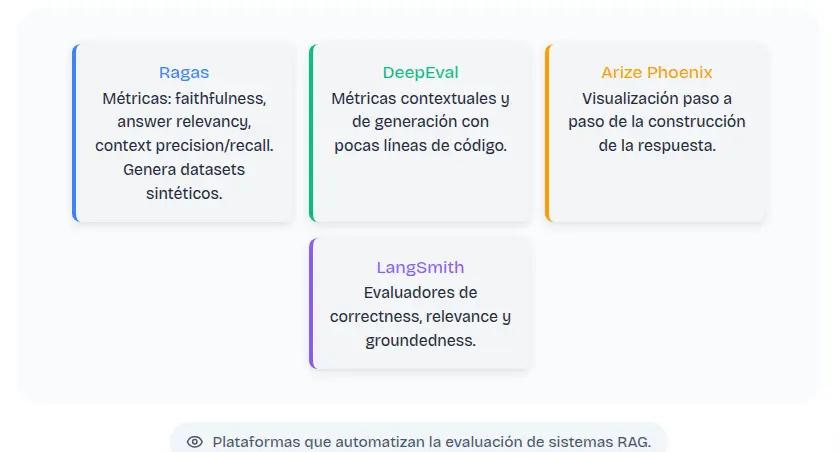

## Evaluación de Métricas

 Un sistema RAG puede recuperar los documentos adecuados y aun así inventar datos, o responder con información irrelevante.

El marco TRIAD, adoptado por herramientas como TruLens-Eval y Ragas, estructura la evaluación en tres ejes: relevancia del contexto (¿los documentos recuperados son pertinentes?), fidelidad (¿la respuesta se basa exclusivamente en esos documentos?) y relevancia de la respuesta (¿la respuesta aborda la pregunta del usuario?).

Esta separación permite identificar dónde falla el sistema: si el contexto es pobre, hay que mejorar la recuperación; si la respuesta es infiel, el problema está en el generador o en el prompt; si la respuesta es fiel pero no relevante, el contexto recuperado no era el adecuado.

Los errores en RAG pueden originarse en la indexación, la recuperación o la generación. Una evaluación aislada de cada etapa es clave para optimizar el sistema.

## Métricas de recuperación

El primer paso es medir qué tan bien el recuperador selecciona los fragmentos relevantes. Las métricas clásicas de recuperación de información se adaptan perfectamente a RAG.

Precisión@K indica la proporción de documentos relevantes entre los K primeros resultados. Por ejemplo, si recuperas 10 documentos y 7 son relevantes, la precisión es 0.7. Recall@K mide la exhaustividad: de todos los documentos relevantes que existen en la base, ¿cuántos aparecen en el top-K?

Precisión@K VS Recall@K:

Precisión@K: Proporción de documentos relevantes en el top-K. Cuando la calidad de cada resultado es crítica (ej. chatbots)
Recall@K: Cobertura de todos los documentos relevantes en el top-K. Cuando no se puede omitir información importante (ej. medicina, derecho)

MBR: evalua la posición del acierto, un valor alto significa que aparece pronto
MAP: considera la precisión y el orden. Es la metrica de rerankers
NDGC: compara el rankin obtenido con el ranking ideal.

## Metricas de generacion: Fidelidad y Relevancia

La respuesta no debe ni, inventar algo, ni responder algo diferente de lo que se pregunto.

La fidelidad (también llamada faithfulness o groundedness) verifica que cada afirmación de la respuesta esté respaldada por los documentos recuperados.

La relevancia de la respuesta mide qué tan bien la respuesta aborda la consulta original, sin divagar. Una respuesta puede ser fiel al contexto pero irrelevante si el contexto recuperado era incorrecto. Esta métrica también se puede medir con un LLM juez, sin necesidad de una respuesta de referencia.

