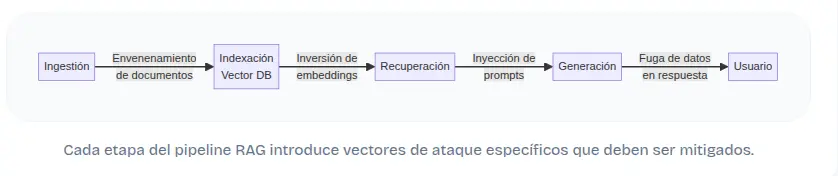
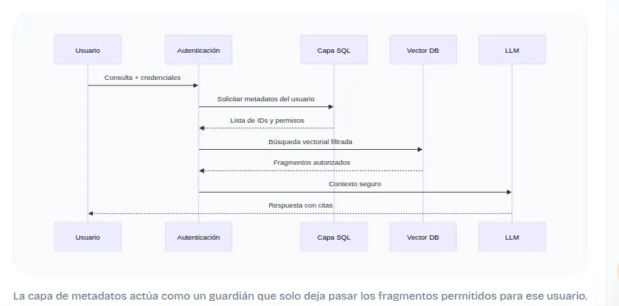
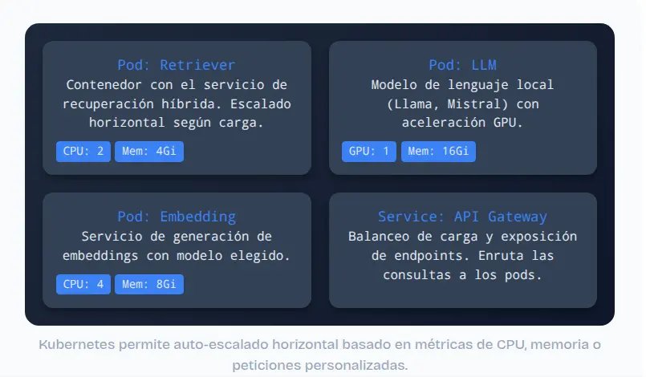

## Seguridad

En esta lección no hablamos de métricas de calidad, sino de confidencialidad, integridad y control. Exploraremos la superficie de ataque ampliada que introduce RAG y, sobre todo, las estrategias concretas para mitigar esos riesgos: clasificación automática, enmascaramiento en la ingestión, control de acceso basado en metadatos, cifrado de la base vectorial y despliegue local de modelos. Porque un sistema que responde bien pero expone datos privados no es un sistema fiable.

La cadena de exposición se extiende a lo largo de cuatro etapas, y cada una presenta riesgos específicos que un atacante puede explotar.

Durante la ingestión, documentos envenenados con información maliciosa pueden contaminar la base de conocimiento si las fuentes no están validadas. En la base de datos vectorial, los embeddings no son inocuos: mediante ataques de inversión, un adversario podría reconstruir el texto original, incluyendo datos personales o confidenciales. La recuperación es especialmente vulnerable a la inyección de prompts, donde una consulta manipulada fuerza la exposición de documentos no autorizados. Finalmente, el modelo generador puede revelar información sensible si el contexto recuperado no fue saneado previamente.

### Clasificacion y etiquetado:

Antes de que un solo fragmento llegue a la base vectorial, debemos saber exactamente qué contiene. La clasificación automatizada de la sensibilidad asigna a cada documento metadatos que indican su nivel de confidencialidad o el dominio regulatorio al que pertenece (datos personales, información financiera, secretos comerciales, etc.). Herramientas como Amazon Comprehend pueden detectar patrones de PII o PHI y etiquetar los archivos durante la ingestión.

Estos metadatos viajan con cada fragmento y se convierten en la llave para la autorización automática. En el momento de la recuperación, el sistema evalúa las etiquetas y bloquea cualquier documento cuyo nivel de sensibilidad supere los permisos del usuario o servicio que realiza la consulta.

La clasificación debe ocurrir antes de generar los embeddings. Si los metadatos no se asignan temprano, pierdes la capacidad de filtrar por sensibilidad en la recuperación.

### Autorizacion basada en roles:

En muchos escenarios —como entornos sanitarios con distintos perfiles profesionales— no basta con eliminar datos sensibles; hay que conservarlos pero garantizando que cada usuario vea solo lo que le corresponde. Aquí entra el control de acceso basado en roles (RBAC) y en atributos (ABAC) apoyado en metadatos.

### Cifrado aislamiento y ataques de inversión

Mediante ataques de inversión, un adversario con acceso a los vectores puede reconstruir el texto original, incluyendo información confidencial. Por eso, la base de datos vectorial debe reforzarse con varias capas de protección.

En primer lugar, el cifrado de los vectores almacenados es imprescindible, junto con políticas de acceso por fila o columna que limiten quién puede leer cada registro. En entornos multiinquilino, el aislamiento lógico de los datos de cada cliente evita consultas cruzadas accidentales o malintencionadas. Además, la monitorización continua permite detectar intentos de extracción anómala, como un volumen inusualmente alto de lecturas sobre un mismo conjunto de vectores.

### Inyección de Prompts y validacion de contexto:

Un asistente RAG puede ser manipulado para que muestre documentos completos o información fuera de alcance si no se valida la intención del usuario. La inyección de prompts busca modificar el comportamiento del sistema mediante instrucciones ocultas en la consulta, forzando la exposición de datos restringidos.

Para prevenirlo, se deben implementar controles como la separación estricta entre resumen y contenido fuente: el usuario solo debe ver síntesis, nunca el documento original completo si no tiene permisos. También es crucial verificar que el contexto recuperado se ajusta a los permisos del usuario antes de enviarlo al LLM. Por último, el AI Red Teaming —simular ataques reales antes del despliegue— permite descubrir puntos ciegos donde el modelo responde “demasiado bien a la pregunta equivocada”.

### Arquitectura recomendada:

