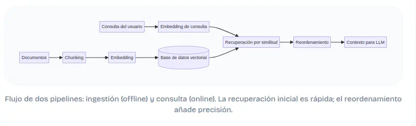
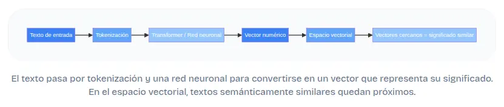

### Introducción

Una alucinación es una respuesta que se da sin contexto, que se da con contenido equivocado o inventado y que suele ocurrir porque el carece de la información correcta o actualizada, o simplemente no posee una fuente para obtener esa información y la inventa.

Una herramienta que atenua estas alucinaciones son el sistema RAG(retrieval augmented generation) o Generación Aumentada por Recuperación.

Podemos definirla como un "marco de inteligencia artificial que integra un componente de recuperación de información en el proceso de generación de los LLM para generar la factualidad y relevancia de las respuestas".

Se combina memoria parametrica(producto del entrenamiento) con memoria no parametrica(documentación personal o propietaria).

> Anotación: asegúrate de que los fragmentos tengan un tamaño adecuado, demasiado pequeños pierden contexto, demasiado grandes saturan el límite de tokens del LLM. Prueba con fragmentos de 200 a 500 palabras como punto de partida.

*Desafios:*

La calidad de la recuperación es crítica: si los documentos recuperados son irrelevantes o de baja calidad, la respuesta generada será deficiente.

RAG también introduce latencia adicional debido al paso de recuperación, lo que puede ser problemático para aplicaciones en tiempo real. La complejidad del sistema aumenta al combinar recuperación y generación, requiriendo una cuidadosa sintonización. Además, RAG puede heredar sesgos presentes en los datos recuperados. Finalmente, el límite de contexto del LLM sigue siendo una restricción: solo se puede incluir una cantidad limitada de texto recuperado en el prompt.




### Chunking

El chunking es el proceso de dividir documentos grandes en fragmentos más pequeños y manejables. La estrategia de chunking es considerada la decisión más impactante en todo el pipeline de RAG, ya que si se elige incorrectamente, ningún componente posterior puede compensarlo.

Los fragmentos demasiado pequeños (100-200 tokens) ofrecen recuperación más precisa pero pierden contexto, mientras que los fragmentos demasiado grandes (500-1000 tokens) preservan más contexto pero reducen la precisión de la recuperación.

El punto óptimo para la mayoría de los casos de uso se sitúa entre 300 y 500 tokens por fragmento, con 50 a 100 tokens de solapamiento entre fragmentos consecutivos para evitar dividir información crítica en los límites.

Estrategias de chunking:

1. Tamaño fijo: divide cada N tokens. Desventaja: ignora la estructura
2. Recursivo por carácteres: Divide por parrafos -> oraciones -> palabras
3. Semántico: usa embeddings para detectar cambios de tema, costoso pero produce segmentos coherentes.
4. Por estructura: usa encabezados, secciones o capitulos. Ideal para documentación tecnica.


El chunking recursivo sería la opción más segura. Es la estrategia por defecto en LangChain y ofrece el mejor compromiso entre velocidad y calidad para textos generales. ¿Cómo funciona? Utiliza una jerarquía de separadores: primero intenta dividir por doble salto de línea (párrafos), luego por salto de línea simple, después por punto (oraciones) y finalmente por espacio. Así, respeta la estructura natural del documento.

Sí, y esa es justo su razón de ser. Unstructured resuelve el problema que tú estabas resolviendo a mano: un único partition() que despacha internamente según el tipo de fichero y devuelve una representación común — una lista de elementos tipados (Title, NarrativeText, Table, ListItem, Header, Footer) con su metadata. Dejas de escribir un if extension == ".pdf" por cada formato.

Formatos que cubre: PDF (nativo y escaneado vía OCR con Tesseract u otros), DOCX, PPTX, XLSX, HTML, XML, EML/MSG (correo con adjuntos), EPUB, Markdown, JSON, CSV/TSV, RTF, ODT, imágenes sueltas, y texto plano. Cada uno pasa por un partition_* específico, pero todos devuelven la misma estructura.

El cambio conceptual importante: no devuelve texto concatenado, devuelve elementos con tipo. Eso te da gratis lo que antes tenías que inferir con heurísticas: sabes qué es un título, qué es una tabla y qué es un párrafo. Y de ahí sale el chunk_by_title(), que agrupa elementos bajo su encabezado respetando la jerarquía — exactamente el troceado estructural del que hablábamos, pero hecho por la librería.

Ejemplo de lo que cambia en tu pipeline:

```Python
from unstructured.partition.auto import partition

elements = partition(filename="contrato.pdf", strategy="hi_res")
chunks = chunk_by_title(elements, max_characters=1500, combine_text_under_n_chars=300)
Copiar
```

strategy="hi_res" usa modelos de layout para detectar tablas y columnas; "fast" es más rápido pero se pierde en maquetación compleja.

Ahora la parte honesta, que importa en legal: no es magia. En PDFs escaneados depende de la calidad del OCR y de que el idioma esté instalado en Tesseract; en documentos con tablas complejas el hi_res mejora mucho pero no es perfecto, y sigue mereciendo la pena revisar una muestra. Además, hi_res es lento y consume recursos — para 5.000 documentos eso son horas, no minutos. Y la instalación con dependencias de layout y OCR no es trivial en un entorno limpio.

Dos contrapartidas más frente a tu enfoque actual: pierdes control fino sobre casos raros que tú ya resolvías con una función a medida, y añades una dependencia grande que evoluciona rápido y rompe compatibilidad entre versiones menores con cierta frecuencia. Conviene fijar la versión en el requirements.txt.

¿Qué pasaría si pudiéramos agrupar oraciones que hablan del mismo tema, incluso si están separadas por párrafos? Eso es exactamente lo que hace el chunking semántico. En lugar de cortar por tamaño o por saltos de línea, esta técnica calcula la similitud semántica entre oraciones consecutivas usando embeddings. Si la similitud del coseno supera un umbral (por ejemplo, 0.75), las oraciones se fusionan en el mismo chunk; si cae por debajo, se crea un nuevo chunk.


### Embedding: de texto a vectores

Los modelos de embedding transforman fragmentos de texto en vectores numéricos que capturan el significado semántico, de modo que contenidos similares producen vectores cercanos en el espacio geométrico. Este proceso es fundamental porque permite la búsqueda semántica: encontrar documentos conceptualmente relacionados con una consulta, no solo aquellos que coinciden en palabras clave.


En el proceso de RAG, tanto los documentos como la consulta del usuario se convierten en vectores mediante el mismo modelo de embedding. La elección del modelo de embedding afecta tanto a la recuperación semántica como a la latencia del sistema; embeddings de mayor calidad mejoran la relevancia de la recuperación pero aumentan el costo computacional.


### Reordenamiento

El reordenamiento es una etapa posterior a la recuperación inicial que a menudo proporciona la mayor mejora de calidad en una implementación de RAG. Mientras que la recuperación inicial utiliza modelos ligeros (bi-encoders) para buscar rápidamente entre grandes volúmenes de documentos, el reordenamiento emplea modelos más precisos (cross-encoders) que evalúan la relevancia de cada fragmento recuperado en el contexto de la consulta específica.

La recuperación como paso previo a la respuesta requiere un sistema estructurado, que transforme documentos en piezas buscables, las convierta en vectores semánticos y seleecione los mas parecidos.

La recuperacion se encuentra entre:

- Indexación: sirve para almacenar contenido, y agregar campos que mejoren la clasificacion del mismo(titulos, notas, citas, paginas numeradas, etc), se los llama metadatos
Determina velocidad y precisión en la consulta, y en la fundamentación de las respuestas, un indice bien diseñado permite recuperaciones rapidaz y consistentes.

y entre:

- Reordenamiento: El reordenamiento es considerado la mejora de mayor retorno en RAG, ya que filtra el ruido y prioriza los fragmentos verdaderamente relevantes, incluso con un embedding modesto.

### Harness de evaluación

En ingeniería de software, un harness es el andamiaje de pruebas que envuelve al sistema bajo prueba: el código que lo arranca, le inyecta entradas controladas, captura las salidas y las compara contra lo esperado. La idea central es que el componente no se prueba a mano cada vez, sino a través de una estructura reproducible que ejecuta cientos de casos y te dice cuáles fallan.

Un harness de evaluación aplicado a RAG es exactamente eso, pero con preguntas y respuestas en vez de asserts booleanos. Consta de: un conjunto de evaluación (preguntas reales de clientes con su documento fuente correcto y la respuesta esperada), un runner que ejecuta el pipeline completo para cada pregunta, y un conjunto de métricas que puntúan el resultado.

Estructura de un harness:

Concretamente, tres artefactos separados:

- El dataset de evaluación — una lista de casos: pregunta, respuesta esperada, y el identificador del documento o artículo que debería recuperarse. Esto es lo que guardas y versionas.
- El índice — ya construido, con tus documentos troceados y vectorizados. El harness nunca lo toca directamente, solo lo consulta vía pipeline.retrieve().
- El bucle — recorre los casos, llama al pipeline, y acumula resultados en una lista.

### Metadatos

Cada fragmento de documento debe llevar metadatos asociados que incluyan información como el título del documento fuente, el encabezado de la sección, el número de página, la fecha y cualquier otro atributo relevante para el caso de uso. Los metadatos cumplen dos funciones críticas en el sistema de recuperación: permiten la recuperación filtrada (por ejemplo, "buscar solo en el manual de recursos humanos") y permiten que el modelo cite las fuentes en sus respuestas.

En implementaciones empresariales, los metadatos también pueden incluir controles de acceso y permisos para garantizar que la recuperación respete las políticas de seguridad de la organización.

*Embeddings*

Los embeddings transforman palabras en vectores numéricos que capturan el sentido semántico, y cómo las bases de datos vectoriales indexan millones de esos vectores para encontrarlos en milisegundos. Sin estos componentes, un sistema RAG sería como una biblioteca sin catálogo: tendrías todos los libros, pero no podrías encontrar nada.

Un embedding es una representación matemática de un texto en forma de vector de números de punto flotante, normalmente de 384 a 1536 dimensiones. El proceso comienza con la tokenización: el texto se divide en unidades (palabras o subpalabras) que el modelo puede procesar. Luego, una red neuronal —generalmente un Transformer— analiza esas unidades y produce un vector final que comprime el significado y el contexto de todo el fragmento.

> Una enfermera escribe en el sistema: 'dosis de paracetamol para niños de 3 años'. El asistente RAG recupera un artículo titulado 'Administración pediátrica de acetaminofén' porque los embeddings relacionan sinónimos y contextos, aunque las palabras exactas no coincidan.



Indices ANN:

Las bases de datos tradicionales como MySQL no están optimizadas para buscar similitud en vectores de alta dimensionalidad. Aquí entran los índices de vecinos más cercanos aproximados (ANN), que reducen la complejidad de búsqueda de O(n×d) a tiempo logarítmico, permitiendo consultas en milisegundos sobre millones de vectores.

Dos algoritmos destacan: HNSW (Hierarchical Navigable Small World) construye un grafo jerárquico: navega desde nodos de nivel superior a inferiores para encontrar vecinos. Es rápido y preciso, pero consume más memoria. IVF (Inverted File Index) divide el espacio en celdas y solo busca en las más cercanas, lo que ahorra memoria pero puede ser menos preciso. También se emplea Product Quantization para comprimir vectores y reducir el uso de memoria hasta en un 75%.

---

Un desafío importante es la actualización de datos: añadir nuevos documentos requiere reindexar todo el conjunto porque el valor de cada vector depende del resto de datos. Cambiar el modelo de embedding obliga a regenerar todos los vectores, con el consiguiente coste computacional. Estas limitaciones han llevado a alternativas como GraphRAG, que construye un grafo de relaciones entre nodos para mejorar el razonamiento multi-salto.

