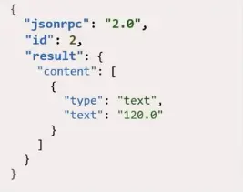

# Model Context Protocol

1. [Concepto](#concepto)
2. [Core del MCP](#core-del-mcp-host-clients-servers-primitives)
    - [Ciclo de vida de un MCP](#ciclo-de-vida-de-un-mcp)
    - [¿Por qué se usa JSON-RPC 2.0?](#por-qué-se-usa-json-rpc-20)
3. [Implementación en un agente](#implementación-en-un-agente)
4. [Ejemplo en el mundo real](#ejemplo-en-el-mundo-real)

### Concepto

Es un protocolo creado por Anthropic que estandariza cómo un agente se conecta con herramientas o fuentes externas. Ofrece una interfaz universal para realizar esta integración de manera segura. Bajo la idea de estandarización, la premisa es que cualquier cliente que cumpla con ciertos requisitos puede conectarse a cualquier servidor que soporte este protocolo.

Para entender el problema que resuelve debemos remontarnos a la arquitectura previa a su existencia: para que un modelo pudiera acceder a una herramienta o información de un servicio, debía utilizar un SDK o una API específica del proveedor, adaptándose obligatoriamente a sus estándares y métodos individuales. Esto provocaba que, al requerir múltiples servicios, existieran múltiples interfaces con requisitos diferentes, complicando drásticamente el desarrollo y mantenimiento de cada conexión.

Con MCP, esta complejidad se elimina mediante una arquitectura desacoplada donde existen clientes que se conectan de manera homogénea a servidores MCP encargados de exponer las conexiones.

### Core del MCP (host, clients, servers, primitives)

Existen varias capas y conceptos clave que permiten entender el funcionamiento interno de un MCP:

1. **Host:** Es la aplicación de IA principal con la que interactúa el usuario final (por ejemplo, Claude Desktop, Cursor, VS Code, etc.). El Host actúa como el contenedor y coordinador principal; se encarga de gestionar la seguridad, las autorizaciones de usuario y la integración final con el LLM.
2. **Client:** Son componentes creados e instanciados por el Host. Cada cliente mantiene una conexión directa y aislada en una **relación estricta 1:1 con un servidor específico** (un cliente dedicado para GitHub, un cliente dedicado para Slack). Se encargan de traducir los mensajes de forma bidireccional.
3. **Server:** Son programas ligeros e independientes que exponen de forma segura los recursos, herramientas o flujos de trabajo que el LLM necesita. Operan de forma aislada y no conocen el historial de la conversación ni la existencia de otros servidores en el ecosistema.
4. **Primitives (Primitivas):** Son las capacidades estándar que los servidores exponen a los clientes, divididas en tres tipos fundamentales:
   * **Resources:** Fuentes de datos e información legibles por el modelo (como archivos locales, textos de logs o respuestas estáticas de APIs).
   * **Tools:** Funciones ejecutables con efectos secundarios que el modelo puede decidir invocar (como compilar código, crear un archivo o consumir un endpoint externo).
   * **Prompts:** Plantillas predefinidas de instrucciones reutilizables que ayudan a guiar al modelo en tareas y flujos comunes.

> 💡 **Nota sobre el transporte:** La comunicación entre cliente y servidor se realiza mediante el estándar JSON-RPC 2.0. Estos servidores pueden correr localmente (comunicándose mediante `stdio`) o de manera remota (utilizando Server-Sent Events - `SSE` sobre HTTP), y pueden ser de desarrollo propio o pertenecer a un tercero.

> 🔀 **Flujo de orquestación:** Ningún servidor interactúa con otro directamente, ni un solo cliente se conecta a múltiples servidores en paralelo. Es el **Host** el encargado de gestionar múltiples instancias de clientes simultáneamente. Si el LLM necesita resolver una tarea compleja multiplataforma, el **Host** coordinará de forma secuencial las peticiones a través de sus respectivos clientes: primero solicitará datos al cliente del repositorio Git, procesará el contexto obtenido, luego instruirá al cliente de Supabase para actualizar la base de datos y finalmente usará el cliente de Slack para notificar la actualización.

### Ciclo de vida de un MCP

Las sesiones MCP son persistentes y con estado, desarrollándose a través de cuatro fases estrictas:

*   **Inicialización (Handshake):** El cliente inicia la sesión enviando un mensaje `initialize` que contiene la versión del protocolo (JSON-RPC 2.0) y sus capacidades de cliente (como *roots* para delimitar accesos o *sampling* para permitir que el servidor le pida generaciones al LLM). El servidor responde confirmando la compatibilidad y compartiendo sus propios metadatos. Finalmente, el cliente envía una notificación de `initialized` para dar luz verde a la sesión.
*   **Descubrimiento (Discovery):** Una vez abierta la sesión, el host solicita al servidor su listado de capacidades a través de esquemas estructurados. El servidor expone qué *Tools*, *Resources* y *Prompts* tiene a disposición (por ejemplo: *"Tengo disponibles métodos de Git: init, commit, add, pull y push"*). Funciona bajo un concepto similar a los esquemas de herramientas (Tools) de frameworks como LangChain.
*   **Operación (Active Session):** Es el flujo dinámico de trabajo. Cuando el LLM analiza la consulta del usuario y determina que requiere una herramienta externa, el **Host** toma esa decisión y le ordena al **Cliente** enviar una solicitud formal de ejecución. El **Servidor** procesa la lógica nativa del sistema, aplica los controles de seguridad y devuelve los datos estructurados al cliente para integrarlos de vuelta al contexto del modelo.
*   **Cierre (Shutdown):** Los canales de comunicación **permanecen abiertos y activos** durante toda la vida útil de la sesión para soportar interacciones continuas o streaming de logs. El cierre no ocurre por cada operación individual; se ejecuta de forma ordenada mediante una solicitud de `shutdown` y un mensaje de `exit` únicamente cuando el Host termina la tarea global, el usuario cierra la aplicación o expira un tiempo de espera, liberando así los procesos de memoria (`stdio` o conexiones `SSE`).

### ¿Por qué se usa JSON-RPC 2.0?

Representa y las trasferencia de información estructurada, a diferencia de una api rest que puede ser implementada de muchas maneras

> Host request -> server

> Server result -> host

Cuando el servidor mcp es local(proceso secundario en la misma maquina), el estandar de comunicacón es stdin/stdout. Si el servidor es remoto, usamos SHT(Streameable HTTP Transport, la conexión se da mediante un metodo post y el descubrimiento mediante SSE streaming). Ambos sistema usan el mismo protocolp JSON-RPC, asi que podemos usar cualquiera de las dos capa de transporte.

